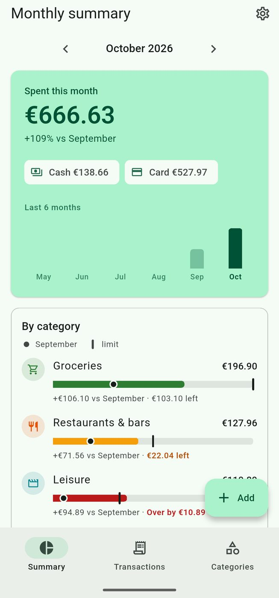
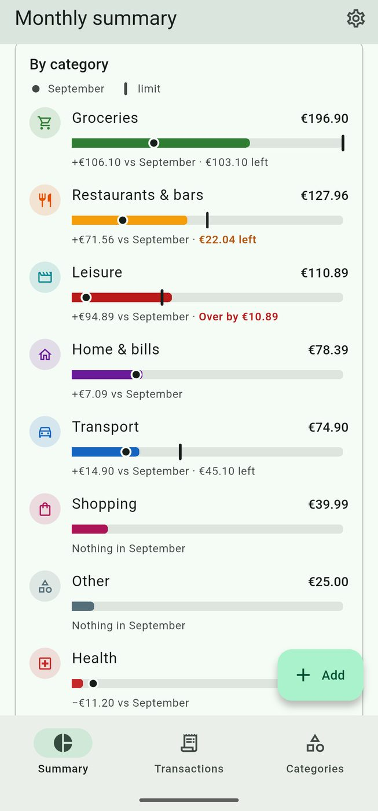
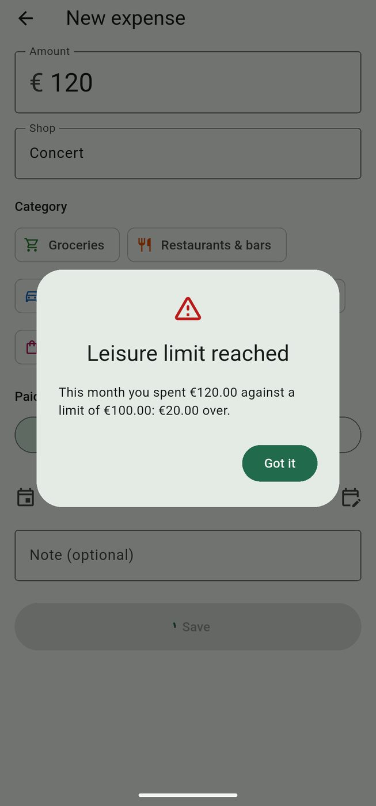

<p align="center">
  
</p>

<h1 align="center">Receipt</h1>

<p align="center">
  On-device receipt scanner and expense tracker for Android.<br/>
  <a href="https://emanuelegaliano.github.io/Receipt/">Website</a> ·
  <a href="https://github.com/emanuelegaliano/Receipt/releases/latest/download/receipt.apk">Download APK</a> ·
  <a href="https://github.com/emanuelegaliano/Receipt/releases">Releases</a>
</p>

> The app is available in **English** and **Italian** (Settings → Appearance → App language; by default it follows
> the phone). It reads both English and Italian receipts.

Receipt tracks what you spend by card and in cash, entirely on your phone. Photograph a receipt and **RapidOCR**
(the same PP-OCRv4 models used by [PyReceipt](https://github.com/emanuelegaliano/PyReceipt)), ported to Dart and
running on ONNX Runtime, reads it; the PyReceipt parser (`Spatial2DBoxParser`) extracts the shop, the date and the
total. No account, no cloud, no internet permission.

From the original idea of PyReceipt: <https://emanuelegaliano.github.io/PyReceiptWebsitePage/>

<p align="center">
  
  
  
  
</p>
<p align="center"><sub>Screenshots from the Android emulator with made-up data.</sub></p>

## Features

- **Receipt scanning**: camera or gallery → OCR → a pre-filled form with amount, date, shop, suggested category and
  payment method (detected from lines such as "pagamento elettronico" or "contante"). You check it and save.
- **Monthly summary**: total for the month, change from the previous month, card vs cash, the last six months as
  columns, and one bar per category on a shared scale with last month's value and the limit marked.
- **Categories that learn**: name, icon, colour and keywords are editable. When you save an expense the shop is
  linked to its category, so next time it is suggested automatically, even if the OCR misspells the name.
- **Monthly limits**: set a limit per category; you get a note at 80% and an alert when you reach it.
- **Movements** grouped by day, with search, filters and swipe-to-delete with undo.
- **Manual entry** for expenses without a receipt.
- **Lock**: password on first launch, optional fingerprint, automatic lock after 30 s in the background.
- **Backup**: export the database and all receipt photos to a .zip, restore it on another phone.
- **Language and themes**: English or Italian; system, light or dark theme with six accent colours.

## Install

Download `receipt.apk` from the [latest release](https://github.com/emanuelegaliano/Receipt/releases/latest),
open it on the phone and allow installs from that app. Android 7.0+ (64-bit). Updates install over the previous
version and keep your data.

Release APKs are signed with this certificate (SHA-256):

```
03:F0:2B:FF:43:57:52:E7:72:07:89:B7:10:26:B3:85:1F:B1:DA:46:70:9F:EC:16:DE:F5:A9:A5:EC:B6:0C:66
```

## Project structure

```
lib/ocr/          RapidOCR 1.4.4 port (pipeline, DBNet post-processing, Clipper, cv2 resize/warp)
lib/receipt/      PyReceipt parser, dates, shop/category suggestion, payment method
lib/data/         SQLite database (drift), budgets, backup export/import, demo data
lib/security/     app lock (password hash, fingerprint)
lib/ui/           screens
lib/l10n/         translations (app_it.arb is the template, app_en.arb), generated with gen-l10n
assets/models/    ONNX models + dictionary (generated by tools/export_models.py)
assets/parser/    PyReceipt language configs (it, en)
site/             project website (Vite + Tailwind), deployed to GitHub Pages
tools/            Python reference scripts, benchmarks, synthetic receipts, icon generator
test/             unit tests (parity with OpenCV/RapidOCR/PyReceipt, logic, database, backup)
integration_test/ OCR parity and SROIE benchmark on a device/emulator
```

Code comments and commit messages are mostly in Italian.

## Development

```bash
flutter emulators --launch Medium_Phone_API_37.0
flutter run
```

After changing `lib/data/database.dart`:

```bash
dart run build_runner build --delete-conflicting-outputs
```

A build made with `--dart-define=DEMO=true` adds *Carica dati di prova* (load demo data) to the settings, used for
the screenshots.

### Tests

```bash
flutter test
```

End-to-end benchmark on the emulator (OCR + Dart parser), serving the SROIE 2019 test split over HTTP:

```bash
(cd /path/to/SROIE2019/test && python3 -m http.server 8765 --bind 127.0.0.1) &
adb reverse tcp:8765 tcp:8765
flutter test integration_test/sroie_benchmark_test.dart -d emulator-5554 > sroie.log
grep SROIE_SUMMARY sroie.log
```

With `--dart-define=LANG=it` and `datasets/italian_synthetic` served instead, it runs on synthetic Italian receipts
(`python tools/make_italian_samples.py datasets/italian_synthetic 30`).

Python baseline (RapidOCR + PyReceipt) and parser fixtures need Python 3.12 with `rapidocr_onnxruntime==1.4.4`,
`onnx`, `pytesseract` and `psutil`:

```bash
python tools/sroie_baseline.py /path/to/SROIE2019/test out en
python tools/make_parser_fixture.py out test/fixtures/sroie_parser.json.gz
```

### Release signing

Release builds read the keystore path and passwords from `android/key.properties` (ignored by git, see
`android/key.properties.example`). Without it, the release build falls back to the debug key and prints a warning.

## Releases and website

`.github/workflows/release.yml` runs on every push to `main`:

1. builds the signed APK and, if the version in `pubspec.yaml` has no release yet, publishes it as
   `receipt.apk` in a new GitHub Release `v<version>`;
2. builds the website in `site/` and deploys it to GitHub Pages.

To publish a new version, bump `version:` in `pubspec.yaml` (e.g. `0.2.0+2`) and push.

The APK job needs two repository secrets:

| Secret | Value |
|---|---|
| `ANDROID_KEYSTORE_BASE64` | the release keystore, base64-encoded |
| `ANDROID_KEYSTORE_PASSWORD` | its password |

Without them the workflow still deploys the website and skips the APK.
