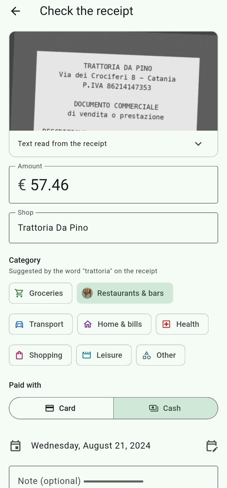
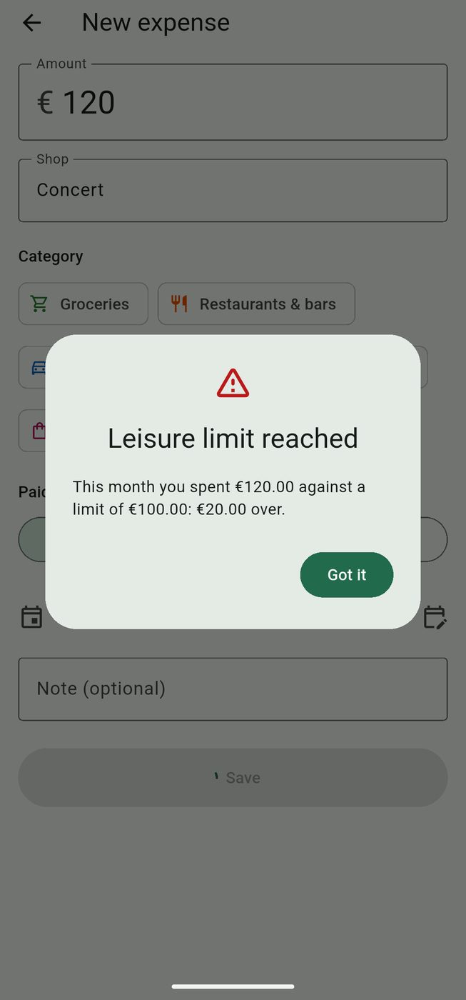

<p align="center">
  
</p>

<h1 align="center">Receipt</h1>

<p align="center">
  On-device receipt scanner and expense tracker for Android.<br/>
  <a href="https://emanuelegaliano.github.io/Receipt/">Website</a> ·
  <a href="https://github.com/emanuelegaliano/Receipt/releases/latest/download/receipt.apk">Download APK</a> ·
  <a href="https://github.com/emanuelegaliano/Receipt/releases">Releases</a>
</p>

> The app is available in **English** and **Italian** (Settings → Appearance → App language; by default it follows
> the phone). It reads both English and Italian receipts.

Receipt tracks what you spend by card and in cash, entirely on your phone. Photograph a receipt and **RapidOCR**
(the same PP-OCRv4 models used by [PyReceipt](https://github.com/emanuelegaliano/PyReceipt)), ported to Dart and
running on ONNX Runtime, reads it; the PyReceipt parser (`Spatial2DBoxParser`) extracts the shop, the date and the
total. Everything runs locally: no account, no cloud, and no data is collected. The internet is used only for two
optional things, both asked about at first launch and changeable in the settings: the update check and the painting
of the day.

From the original idea of PyReceipt: <https://emanuelegaliano.github.io/PyReceiptWebsitePage/>

<p align="center">
  
  
  
  
</p>
<p align="center"><sub>Screenshots from the Android emulator with made-up data.</sub></p>

## Features

- **Receipt scanning**: camera or gallery → OCR → a pre-filled form with amount, date, shop, suggested category and
  payment method (detected from lines such as "pagamento elettronico" or "contante"). You check it and save.
- **Monthly summary**: total for the month, change from the previous month, card vs cash, the last six months as
  columns, and one bar per category on a shared scale with last month's value and the limit marked.
- **Categories that learn**: name, icon, colour and keywords are editable. When you save an expense the shop is
  linked to its category, so next time it is suggested automatically, even if the OCR misspells the name.
- **Monthly limits**: set a limit per category; you get a note at 80% and an alert when you reach it.
- **Month picker**: tap the month name to jump to any month and year.
- **Movements** grouped by day, with search, filters and swipe-to-delete with undo.
- **Manual entry** for expenses without a receipt.
- **Lock and encryption**: password on first launch, optional fingerprint, automatic lock after 30 s in the
  background. The database and the receipt photos are encrypted on the phone with a key that only the password (or
  the fingerprint) opens. See [Encryption](#encryption).
- **Backup**: export the database and all receipt photos to a .zip (asks for the password; the zip is not
  encrypted), restore it on another phone.
- **Updates** (opt-in, asked at first launch): at startup the app reads `version.json` from the website; if there is
  a newer release it shows what's new, downloads the APK, checks its SHA-256 and opens the Android installer (one tap
  to confirm).
- **Painting of the day** (opt-in, asked at first launch): a public-domain painting from The Metropolitan Museum of
  Art behind the main screens, a different one every day out of 600 vertical works, with a slider for how visible it
  is. The "i" at the top shows the whole painting, its data and sources. One image a day (about 0.7 MB) is downloaded
  from Wikimedia Commons; the password screen stays plain. See [Painting of the day](#painting-of-the-day).
- **Language and themes**: English or Italian; system, light or dark theme with six accent colours.

## Encryption

Since 0.3.5 the data on the phone is encrypted (`lib/security/vault.dart`, `lib/security/app_lock.dart`):

- A random 256-bit **data key** is created when the password is chosen. Two sub-keys are derived from it with
  HMAC-SHA256: one for the database, one for the photos.
- **Database**: `spese.sqlite` is opened with SQLite3MultipleCiphers (`PRAGMA key`, its default ChaCha20-Poly1305
  cipher), selected in `pubspec.yaml` under `hooks: user_defines: sqlite3: source: sqlite3mc`. It opens only after
  unlocking; queries made before wait.
- **Photos**: each file in `receipts/` is AES-256-GCM (`RCPTENC1` + nonce + ciphertext + tag), same file name.
- **Password**: never stored. The data key is stored in the Android Keystore (flutter_secure_storage) encrypted with
  a key derived from the password (PBKDF2-HMAC-SHA256, 120,000 iterations, random salt): the password is right if
  it opens it. Changing the password re-encrypts only the data key.
- **Fingerprint**: a second copy of the data key is encrypted with an AES key in the Android Keystore that can only
  be used right after a recognised fingerprint (BiometricPrompt with a CryptoObject, `MainActivity.kt`). Adding or
  removing a fingerprint invalidates it; the app then asks for the password and offers to turn the fingerprint on
  again.
- **Upgrade from 0.3.4 or earlier**: the first unlock must use the password; the data key is created and the
  database (`PRAGMA rekey`) and the photos are encrypted in place. Both steps can be interrupted and resume at the
  next start.
- **Export** writes a plain zip (readable without the app) and asks for the password, not the fingerprint. Temporary
  plain copies (image picker, share sheet, file picker, old exports) are deleted.
- Android auto backup is off: the encrypted database would arrive on another phone without its key.

## Painting of the day

The list of paintings is `assets/art/paintings.json`, generated by `tools/make_paintings.py` (run by hand, not by the
app or CI). No text in it is written for Receipt; everything comes from open sources, cited in the app:

- [The Met Open Access](https://www.metmuseum.org/hubs/open-access) (`MetObjects.csv`, CC0): public-domain status,
  artist, date, medium, dimensions, credit line and the object's page.
- [Wikidata](https://www.wikidata.org) (CC0): the Met paintings with an image, titles and short descriptions in
  Italian and English, links to Wikipedia.
- [Wikimedia Commons](https://commons.wikimedia.org): real image size and licence (only CC0 or public domain, mostly
  The Met's own Open Access photos) and the 1280 px version the app downloads.
- [Wikipedia](https://www.wikipedia.org): the introduction of the article on the painting, where there is one (172 of
  600). These texts are under [CC BY-SA 4.0](https://creativecommons.org/licenses/by-sa/4.0/) and are shown with the
  article title and a link.

Only paintings that are public domain for The Met and at least 1.2 times taller than wide are kept: first those with
a Wikipedia article, then The Met's highlights. The order of the days is shuffled with a fixed seed; regenerating the
list changes which painting falls on which day.

```bash
python3 tools/make_paintings.py /path/to/cache assets/art/paintings.json
```

The cache folder (outside the repository) keeps the downloads, the 341 MB CSV included, so a second run starts from
there.

## Install

Download `receipt.apk` from the [latest release](https://github.com/emanuelegaliano/Receipt/releases/latest),
open it on the phone and allow installs from that app. Android 7.0+ (64-bit). Updates install over the previous
version and keep your data.

Release APKs are signed with this certificate (SHA-256):

```
03:F0:2B:FF:43:57:52:E7:72:07:89:B7:10:26:B3:85:1F:B1:DA:46:70:9F:EC:16:DE:F5:A9:A5:EC:B6:0C:66
```

## Project structure

```
lib/ocr/          RapidOCR 1.4.4 port (pipeline, DBNet post-processing, Clipper, cv2 resize/warp)
lib/receipt/      PyReceipt parser, dates, shop/category suggestion, payment method
lib/data/         SQLite database (drift), budgets, backup export/import, demo data
lib/security/     app lock (password, fingerprint), data key, database and photo encryption
lib/update/       update check (version.json), APK download + SHA-256 check, Android installer
whatsnew/         short "what's new" lines per version, shown in the update dialog
lib/art/          painting of the day: list, daily download, background, info sheet
lib/ui/           screens
lib/l10n/         translations (app_it.arb is the template, app_en.arb), generated with gen-l10n
assets/models/    ONNX models + dictionary (generated by tools/export_models.py)
assets/parser/    PyReceipt language configs (it, en)
assets/art/       paintings of the day (generated by tools/make_paintings.py)
site/             project website (Vite + Tailwind), deployed to GitHub Pages
tools/            Python reference scripts, benchmarks, synthetic receipts, icon generator
test/             unit tests (parity with OpenCV/RapidOCR/PyReceipt, logic, database, backup)
integration_test/ OCR parity and SROIE benchmark on a device/emulator
```

Code comments and commit messages are mostly in Italian.

## Development

```bash
flutter emulators --launch Medium_Phone_API_37.0
flutter run
```

After changing `lib/data/database.dart`:

```bash
dart run build_runner build --delete-conflicting-outputs
```

A build made with `--dart-define=DEMO=true` adds *Carica dati di prova* (load demo data) to the settings, used for
the screenshots.

### Tests

```bash
flutter test
```

Memory stress test: 30 receipts in a row through the real scan → form → save flow, printing the process memory at
every round (images served as for the benchmark below, from a folder with `img/`):

```bash
flutter test integration_test/scan_stress_test.dart -d emulator-5554 --dart-define=ROUNDS=30 | grep STRESS
```

End-to-end benchmark on the emulator (OCR + Dart parser), serving the SROIE 2019 test split over HTTP:

```bash
(cd /path/to/SROIE2019/test && python3 -m http.server 8765 --bind 127.0.0.1) &
adb reverse tcp:8765 tcp:8765
flutter test integration_test/sroie_benchmark_test.dart -d emulator-5554 > sroie.log
grep SROIE_SUMMARY sroie.log
```

With `--dart-define=LANG=it` and `datasets/italian_synthetic` served instead, it runs on synthetic Italian receipts
(`python tools/make_italian_samples.py datasets/italian_synthetic 30`).

Python baseline (RapidOCR + PyReceipt) and parser fixtures need Python 3.12 with `rapidocr_onnxruntime==1.4.4`,
`onnx`, `pytesseract` and `psutil`:

```bash
python tools/sroie_baseline.py /path/to/SROIE2019/test out en
python tools/make_parser_fixture.py out test/fixtures/sroie_parser.json.gz
```

### Release signing

Release builds read the keystore path and passwords from `android/key.properties` (ignored by git, see
`android/key.properties.example`). Without it, the release build falls back to the debug key and prints a warning.

## Releases and website

`.github/workflows/release.yml` runs on every push to `main`:

1. builds the signed APK and, if the version in `pubspec.yaml` has no release yet, publishes it as
   `receipt.apk` in a new GitHub Release `v<version>`;
2. builds the website in `site/` and deploys it to GitHub Pages, with a `version.json` describing the latest
   published release (version, APK URL, size, SHA-256, and the `notes` from `whatsnew/<version>.json`). The app
   reads it to offer updates, so it never announces a version whose APK failed to build.

To publish a new version, bump `version:` in `pubspec.yaml` (e.g. `0.3.2+4`), add a section to
[CHANGELOG.md](CHANGELOG.md), write `whatsnew/<version>.json` (a few short lines in Italian and English, see
[whatsnew/README.md](whatsnew/README.md)) and push.

The APK job needs two repository secrets:

| Secret | Value |
|---|---|
| `ANDROID_KEYSTORE_BASE64` | the release keystore, base64-encoded |
| `ANDROID_KEYSTORE_PASSWORD` | its password |

Without them the workflow still deploys the website and skips the APK.
